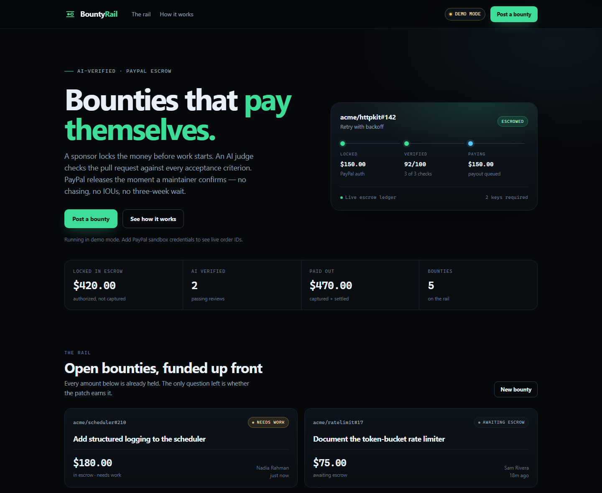

# BountyRail

**Bounties that pay themselves.**

Open-source bounties are promised in an issue and paid weeks later, if ever. BountyRail locks the
money before the work starts, has an AI judge check the pull request against the acceptance
criteria, and releases a PayPal payout when a maintainer confirms.

Built for the [PayPal AI Hackathon](https://paypalaihackathon.devpost.com/).

**Live demo:** [bountyrail.vercel.app](https://bountyrail.vercel.app) · **Repo:** [github.com/Aryamanironman/bountyrail](https://github.com/Aryamanironman/bountyrail)

> The hosted demo runs with the PayPal sandbox and Groq (`openai/gpt-oss-120b`). Vercel's filesystem is ephemeral, so after a cold start click **Load demo bounties** on the home page.



## Why this is different

- **PayPal is the rail, not a badge.** A real `AUTHORIZE` order holds the sponsor's funds; a
  `CAPTURE` moves them; a Payouts batch settles with the contributor. Every ID is stored on the
  bounty and shown in the UI.
- **Two keys.** The AI produces evidence and a verdict, but it has no capture credential. The
  release endpoint refuses to run without `{ confirm: true }` from a maintainer.
- **Works without keys.** With no PayPal credentials the app runs in labelled demo mode; with no
  model key it falls back to a deterministic judge. Both are visibly labelled, never silently
  substituted.

## The flow

1. **Sponsor posts a bounty.** The amount is authorized (held, not captured) through PayPal Orders
   v2. The contributor can see that the money exists.
2. **A patch arrives.** Submit one manually, or merge a pull request and let the GitHub webhook
   pick it up.
3. **The AI judge reviews.** It receives the diff, the test output and each acceptance criterion,
   then returns `pass` / `fail` / `needs_review`, a score, and one evidence line per criterion.
4. **The maintainer releases.** A second confirmation captures the authorization and sends a
   PayPal payout to the contributor's email. A failed payout is recorded and retryable.

```
sponsor ──authorize──▶ PayPal order ──capture──▶ platform ──payout──▶ contributor
                          ▲                                              ▲
                          │                                              │
                    AI verdict + human confirm                    GitHub webhook
```

## Run it locally

```bash
npm install
cp .env.example .env.local     # optional: add PayPal / AI keys
npm run dev                    # http://localhost:3100
```

The database starts empty. Click **Load demo bounties** on the home page, or:

```bash
curl -X POST http://localhost:3100/api/seed
```

Then open a bounty and click **Run AI review (demo patch)**, followed by the release confirmation.

## Enable live PayPal sandbox calls

1. Sign in at [developer.paypal.com](https://developer.paypal.com/dashboard/applications/sandbox)
   and create a **Sandbox app** under *Apps & Credentials*.
2. Put the client ID and secret in `.env.local`:

   ```bash
   PAYPAL_CLIENT_ID=...
   PAYPAL_CLIENT_SECRET=...
   PAYPAL_ENV=sandbox
   PUBLIC_BASE_URL=http://localhost:3100
   ```

3. Restart the dev server. The header switches from **Demo mode** to **PayPal sandbox**.
4. Create a sandbox **personal** account for the contributor's email
   (Testing Tools → Sandbox Accounts). Payouts are sent by email, so the receiver must exist.
5. Post a bounty, open the approval link, log in as the sandbox buyer, approve, then click
   **I've approved — lock escrow** on the bounty page.
6. Run a review, confirm the release, and check the **PayPal trail** panel for the real
   order / authorization / capture / payout IDs.

Notes:

- The order uses `intent=AUTHORIZE`; its capture creates an **authorization hold**. Funds move only
  when the maintainer releases, via `/v2/payments/authorizations/{id}/capture`.
- Payouts require the Payouts capability and a funded sandbox business account. A payout failure
  leaves the bounty in `PAYOUT_FAILED` with the error surfaced and a **Retry payout** button.
- `PUBLIC_BASE_URL` must be reachable by the browser; for a hosted demo use the deployed URL.

## Enable the AI judge

Any OpenAI-compatible chat-completions endpoint works.

```bash
AI_BASE_URL=https://api.anthropic.com/v1
AI_API_KEY=sk-ant-...
AI_MODEL=claude-sonnet-5-5
```

The judge asks for strict JSON and validates the shape server-side. If the request fails, the
response is unusable, or no key is configured, it falls back to `bountyrail-heuristic-v1` and every
surface labels the result as a deterministic fallback. The model never receives capture or payout
credentials.

## GitHub webhook

1. Create a secret and add it as `GITHUB_WEBHOOK_SECRET`.
2. In the repo: *Settings → Webhooks → Add webhook*.
   - Payload URL: `<PUBLIC_BASE_URL>/api/webhooks/github`
   - Content type: `application/json`
   - Secret: the same value
   - Events: **Pull requests**
3. Merged PRs are reviewed automatically. A PR matches an escrowed bounty when its body references
   `#<issue>` (or the bounty ID, or a `bounty:<id>` / `bountyrail` label). With no reference, the
   newest escrowed bounty for that repo is used.
4. `GITHUB_TOKEN` is optional and only needed for private repositories.

Webhook delivery is signature-verified with HMAC-SHA256; unsigned requests are rejected.

## API

| Method | Route | Purpose |
|---|---|---|
| `GET` | `/api/health` | PayPal mode, AI/webhook configuration |
| `GET` | `/api/bounties` | List bounties |
| `POST` | `/api/bounties` | Create a bounty and its authorization order |
| `GET` | `/api/bounties/:id` | Read one bounty |
| `POST` | `/api/bounties/:id/escrow` | Turn an approved order into a held authorization |
| `POST` | `/api/bounties/:id/submissions` | Review a patch (`{"useDemo":true}` for the sample) |
| `POST` | `/api/bounties/:id/release` | Capture + payout; requires `{"confirm":true}` |
| `POST` | `/api/webhooks/github` | Signature-verified merged-PR handler |
| `POST` | `/api/seed` | Load four demo bounties (idempotent) |

## State machine

```
AWAITING_APPROVAL ──approve──▶ ESCROWED ──review pass──▶ VERIFIED ──confirm──▶ PAID
                                   │                        │
                                   └──review fail──▶ NEEDS_WORK
                                                            │
                                       capture ok, payout ✕ ─┴──▶ PAYOUT_FAILED ──retry──▶ PAID
```

Illegal transitions are rejected with `409` and a machine-readable `code`. A second release on a
paid bounty returns `ALREADY_PAID`.

## Tests

```bash
npm test        # 26 tests: validation, judge, webhook matching, PayPal mock, full pipeline
npm run build   # type-check + production build
```

The pipeline tests run the entire create → authorize → review → release flow against mock PayPal
and a temporary data directory.

## Layout

```
app/                 Next.js App Router pages and API routes
components/          Server and client UI
lib/paypal.ts        Orders v2, authorization capture, Payouts
lib/judge.ts         LLM judge + deterministic fallback
lib/pipeline.ts      State machine and money movement
lib/db.ts            JSON store with an in-process write lock
lib/github.ts        Webhook verification and PR matching
tests/               Vitest suites
docs/DEMO_SCRIPT.md  Three-minute video shot list
docs/SUBMISSION.md   Devpost copy
```

## Limitations and honesty

- **This is not a licensed escrow service.** PayPal authorization holds reserve funds; they are not
  held in trust. Real deployment needs legal review, contributor agreements and tax handling.
- On release, funds are captured into the platform account and then paid out. A payout failure is
  surfaced and retryable, but that window is real.
- Data is a local JSON file. On Vercel the filesystem falls back to `/tmp`, which is ephemeral; use
  Render with a persistent disk for a durable hosted demo.
- The heuristic fallback is deliberately conservative and never moves money on its own. The LLM can
  still be wrong; that is exactly why a human holds the second key.
- There is no authentication or multi-tenancy. It is a hackathon prototype, not a production
  marketplace.

## License

MIT — see [LICENSE](LICENSE).
